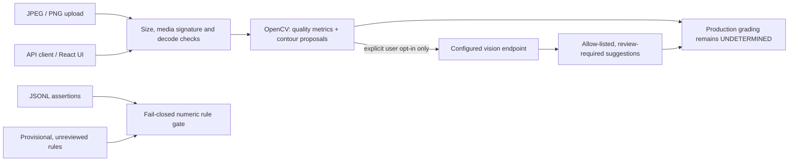

# Current architecture and implemented dataflow

## Implemented

- **Photo endpoint (`POST /v1/inspect`):** Accepts JPEG/PNG request bodies up to 10 MiB, enforces a decoded-pixel ceiling, verifies media signatures, calculates an image hash, and never persists the uploaded bytes.
- **OpenCV (`backend/app/vision/inspection.py`):** Reports dimensions, Laplacian blur variance, clipped-exposure percentage, and simple contour proposals with pixel features. It does not identify a confirmed joint or calculate solder-specific measurements. Its thresholds are provisional.
- **Optional vision suggestions (`backend/app/tf/vision.py`):** Sends the image to the configured compatible API only when `model_assist=true`. Model outputs are restricted to recognized region IDs, joint-type labels, and condition codes. These are suggestions, not verified evidence, and are not connected to grading.
- **Production grading:** Every photo analysis returns `UNDETERMINED`, with reasons that identify missing solder-specific measurement, rule review, and validation. The photo endpoint never issues an actionable accept/reject decision.
- **Rule gate (`backend/app/gate/gate.py`):** Applies numeric rule thresholds only for reviewed rules and explicitly trusted internal measurements. API and JSONL assertions remain untrusted. No model calls occur inside the gate.
- **Status UI (`frontend/`):** Provides file upload, explicit model-sharing consent, image analysis display, progress/cancel states, and abstention explanations.
- **Batch runner (`jobs/run_gate_batch.py`):** Processes local JSONL assertions and remains fail-closed for untrusted input.

## Not implemented / not validated

Solder-specific pixel segmentation and measurement, trained joint detection, calibration, ground-truth evaluation, production rule approval, confidence calibration, accuracy reporting, auth/rate limits, and industrial deployment are still absent. A successful synthetic test is not evidence of real-world accuracy. See `LIMITATIONS.md` and the aspirational `SPEC.md`.
